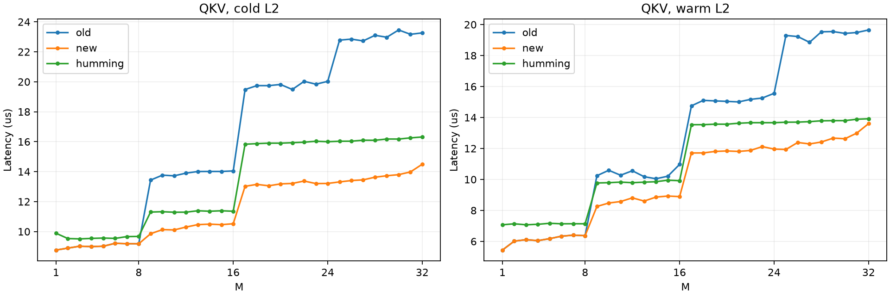
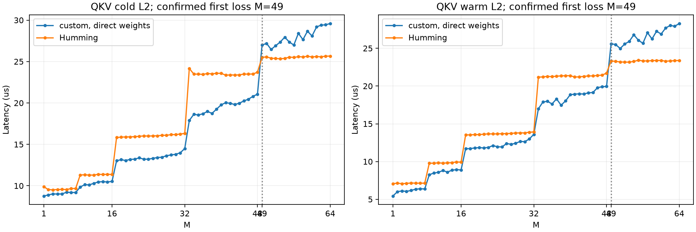

# RTX 3060 W4A16 measurement archive

These are standalone kernel microbenchmarks on Qwen2.5-1.5B-Instruct-GPTQ-Int4
layer 0. All current kernels use one shared Humming-layout parameter allocation,
FP16 activations/scales/dequantization/output and FP32 accumulation, group128.
Weights bypass shared staging; the split-K output reduction uses shared memory.
This is experimental work assisted by Codex, not an integrated vLLM backend.

## Results and version scope

| Projection | K | N | First confirmed loss, cold L2 | Warm L2 |
| --- | --- | --- | --- | --- |
| QKV, newly tuned row reuse | 1536 | 2048 | M=49 | M=49 |
| O, original 8-row blocks | 1536 | 1536 | M=25 | M=25 |
| Gate/up, original 8-row blocks | 1536 | 17920 | M=9 | M=9 |
| Down, original 8-row blocks | 8960 | 1536 | M=9 | M=9 |

The QKV row-reuse tuning has not been transferred to the other three
projections. These are boundaries of the measured implementations, not limits
of all direct-load kernels. Small-M down wins are below 1% near M=8.

- [QKV optimization and shared-staging ablation](shared-qkv-reuse-compare/report.md)
- [QKV M=1-64 crossover](shared-qkv-crossover-compare/report.md)
- [O, gate/up and down M=1-32](shared-other-current-compare/report.md)





## Measurement protocol and checks

- NVIDIA RTX 3060 SM86, PyTorch 2.13.0+cu132, nvcc 12.9, CUPTI 13.4.
- Humming commit `81402fe03040e1233afeea88f3420db7ba01302d`.
- vLLM base commit `b8e9001bf9568c801985889deff34d3b9fe6d0b0`.
- FlashInfer CUPTI CUDA-graph timing, fixed parameter pointers, 100 ms warmup,
  two reversed-order rounds of 150 samples; the QKV crossover boundary uses
  300 samples per round. Cold calls flush a separate 2x-L2 buffer.
- Allocation, compilation, initial weight preparation, CPU references, host
  dispatch and cache flushing are outside measured kernel durations.
- Reference: CPU FP32 matmul of the same FP16-dequantized weights, rounded
  to FP16; fixed atol=0.002, rtol=0.02 and relative L2 below 0.001.
- Selected checks: 320 QKV optimization, 320 custom ablation, 40 layer-14
  boundary checks, 360 QKV extension/boundary and 960 other-projection checks.
  All passed. Optional Humming configurations can fail the strict gate; fixed
  selected configurations must pass before timing is accepted.

M=1 QKV optimization uses the complete independent rerun in
`shared-qkv-reuse-m1-confirm/`. The crossover uses the complete M=48-51 rerun
in `shared-qkv-crossover-boundary/`. The original raw runs, including unstable
rounds, remain available; individual reports explain their provenance.

The ablation compares direct loads, the same direct kernel with equal shared
capacity reserved, immediate cp.async staging and one-step-lookahead staging.
It does not reproduce Humming's entire pipeline or isolate shared-memory
latency from changed instructions, synchronization and register usage.

## Files and reproduction

Each run contains metadata, fixed selections, raw timing CSV with both round
medians, gzip-compressed correctness records and individual timing samples,
error records and any derived report. Summaries and plots
combine the explicitly identified confirmation runs. `SHA256SUMS` hashes the
archived measurement files. Environment-specific paths in JSON and Markdown
are replaced by placeholders; model weights, compiled binaries and caches are
excluded. CSV line endings are normalized to LF. Measured CUDA/harness source
snapshots are gzip-compressed under `source-snapshots/<sha256>/`, matching each
run's original metadata hashes even where the harness or experiment entries
were extended later.

Set the paths below to an existing CUDA environment, the pinned Humming source
and package, an isolated CUPTI package and the checkpoint directory:

```bash
LIBRARY_PATH=/usr/lib/wsl/lib .venv/bin/python \
  benchmarks/kernels/w4a16_gemv/shared_layout_benchmark.py \
  --model /path/to/Qwen2.5-1.5B-Instruct-GPTQ-Int4 \
  --cupti-root /path/to/cupti-package \
  --humming-root /path/to/humming-package \
  --humming-source /path/to/humming-source \
  --output-dir /tmp/qkv-crossover-boundary \
  --phase compare --layers qkv_proj --max-custom-m 64 \
  --selection benchmarks/kernels/w4a16_gemv/results/shared-qkv-crossover-tune/selection.json \
  --batches 48 49 50 51 --repeats 300
```

For M=1-32 QKV, use `shared-qkv-reuse-tune/selection.json` and optionally
`--reference-selection .../original-selection.json` for the old custom path.
For O/gate-up/down use `original-selection.json` and `--max-custom-m 32`.
The saved metadata lists exact batches and settings for each run. The harness
was extended from M<=32 to M<=64 after the small-M measurements; CUDA source
is unchanged between those current-kernel campaigns.
