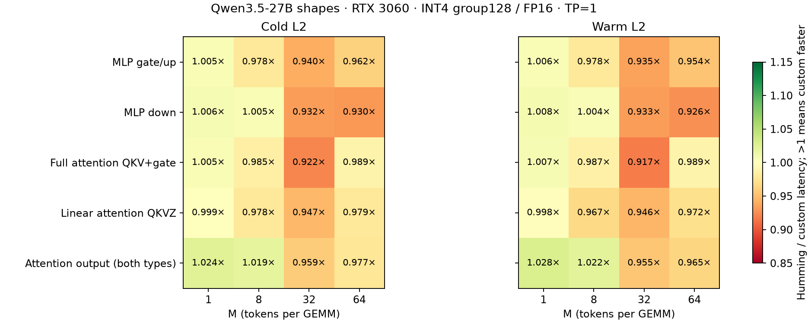

# Qwen3.5-27B W4A16 projection comparison

The current custom kernels are close to Humming at M=1. At M=32, Humming has lower latency for all five measured projection shapes. These results do not establish an overall custom-kernel advantage on Qwen3.5-27B dimensions.

RTX 3060 12GB, TP=1; synthetic symmetric INT4 group128 weights, FP16 activations/dequant/output, FP32 accumulation, no bias. No model checkpoint was loaded. Both implementations read identical Humming-transformed weight and scale allocations.

Shapes follow the [official model configuration](https://huggingface.co/Qwen/Qwen3.5-27B/blob/main/config.json), archived as model_config.json. QKV includes the attention output gate. The output projection has the same dimensions for both attention types and is measured once. Small linear-attention b/a projections, embeddings, LM head, vision, attention computation and nonlinear operations are excluded.

A separate coarse tuning run screens 13 existing custom configurations and Humming default/stage-2/no-Stream-K variants where applicable. M=1 is retuned with two reversed-order rounds, 50 ms warmup and 40 samples after transient first-case timing affected initial choices. Confirmation fixes the selected configuration for each shape, M and cache case and uses a different random seed. Four reversed-order rounds use 100 ms warmup and 150 CUPTI CUDA-graph samples per implementation. Values are medians of round medians; allocation, compilation, initial transformation and cold-L2 flushing are outside timing.

All 80 independent decoded-weight FP32 reference checks pass relative L2 < 0.001 and atol=max(0.002, 0.002*reference_RMS), rtol=0.02. Maximum relative L2: 0.000380796.

Maximum (max-min)/median across the four round medians: 1.15%. This is observed variation, not a confidence interval. Small percentage differences should be interpreted cautiously on this desktop GPU.

## Cold L2

Cells: custom / Humming latency in microseconds (Humming/custom speedup).

| Projection (K × N) | M=1 | M=8 | M=32 | M=64 |
| --- | ---: | ---: | ---: | ---: |
| MLP gate/up (5120 × 34816) | 277.12 / 278.60 (1.005×) | 287.94 / 281.66 (0.978×) | 473.73 / 445.49 (0.940×) | 928.21 / 893.32 (0.962×) |
| MLP down (17408 × 5120) | 141.39 / 142.28 (1.006×) | 142.31 / 143.01 (1.005×) | 257.41 / 240.02 (0.932×) | 498.60 / 463.87 (0.930×) |
| Full attention QKV+gate (5120 × 14336) | 118.06 / 118.66 (1.005×) | 121.37 / 119.57 (0.985×) | 197.14 / 181.74 (0.922×) | 366.04 / 362.11 (0.989×) |
| Linear attention QKVZ (5120 × 16384) | 138.20 / 138.06 (0.999×) | 142.94 / 139.77 (0.978×) | 241.41 / 228.67 (0.947×) | 452.93 / 443.36 (0.979×) |
| Attention output (both types) (6144 × 5120) | 54.05 / 55.35 (1.024×) | 54.61 / 55.64 (1.019×) | 95.13 / 91.22 (0.959×) | 179.67 / 175.55 (0.977×) |

## Warm L2

Cells: custom / Humming latency in microseconds (Humming/custom speedup).

| Projection (K × N) | M=1 | M=8 | M=32 | M=64 |
| --- | ---: | ---: | ---: | ---: |
| MLP gate/up (5120 × 34816) | 273.26 / 274.76 (1.006×) | 284.41 / 278.20 (0.978×) | 476.47 / 445.26 (0.935×) | 936.10 / 892.78 (0.954×) |
| MLP down (17408 × 5120) | 137.43 / 138.54 (1.008×) | 138.98 / 139.60 (1.004×) | 257.67 / 240.30 (0.933×) | 499.99 / 463.18 (0.926×) |
| Full attention QKV+gate (5120 × 14336) | 114.20 / 114.95 (1.007×) | 117.76 / 116.22 (0.987×) | 197.70 / 181.28 (0.917×) | 366.00 / 361.82 (0.989×) |
| Linear attention QKVZ (5120 × 16384) | 134.46 / 134.26 (0.998×) | 140.70 / 136.02 (0.967×) | 241.39 / 228.24 (0.946×) | 456.58 / 443.69 (0.972×) |
| Attention output (both types) (6144 × 5120) | 50.16 / 51.58 (1.028×) | 51.11 / 52.22 (1.022×) | 95.16 / 90.88 (0.955×) | 179.86 / 173.48 (0.965×) |

## Reproduction and scope

Run from the repository root with the existing .venv and dependencies:

```bash
.venv/bin/python benchmarks/kernels/w4a16_gemv/shape_scaling.py --humming-root /home/linxi/.local/state/vllm-qwen-int4/humming-latest-src --cupti-root /home/linxi/.local/state/vllm-qwen-int4/cupti-package --output-dir /home/linxi/.local/state/vllm-qwen-int4/gemv-experiment/qwen35-27b-confirm --build-dir /home/linxi/.local/state/vllm-qwen-int4/gemv-experiment/v41-opt-build --shapes qwen35_27b_gate_up qwen35_27b_down qwen35_27b_qkv_gate qwen35_27b_linear_qkvz qwen35_27b_out --batches 1 8 32 64 --bias-modes none --selection /home/linxi/.local/state/vllm-qwen-int4/gemv-experiment/qwen35-27b-selection.json --seed 1 --rounds 4 --repeats 150 --warmup-ms 100
```

Full configuration selections, useful-work bandwidth/TFLOPS, raw source hashes and round medians are in selection.json, summary.csv and metadata.json. GB/s uses K*N/2 + 2*(K/128)*N + 2*M*(K+N) ideal bytes; TFLOPS uses 2*M*N*K operations. Neither is a hardware-counter measurement.

Raw tuning, confirmation samples and source snapshots remain under /home/linxi/.local/state/vllm-qwen-int4/gemv-experiment. These are individual GEMM timings; no model accuracy or end-to-end serving result is implied. The FP16 activation experiment does not measure BF16 kernels.


