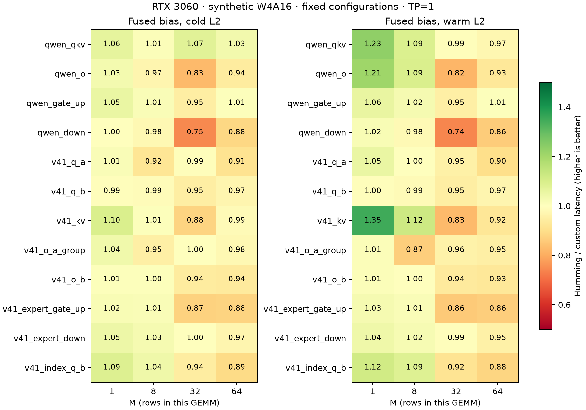

# Wider W4A16 tiling on DeepSeek V4.1 shapes

The optimized family reduces latency by 26–42% on the large Q/output/expert
projections at M=32/64 compared with the previous custom configurations.
It substantially narrows the gap with tuned Humming but does not establish
a universal win. This remains a standalone synthetic W4A16 experiment on
RTX 3060, not native FP8/FP4 model inference or a serving-backend integration.

## Controlled confirmation

All three arms read identical transformed weights/scales and fuse the same
nonzero bias. Configurations are fixed from a separate tuning run; the old
custom path is a control and is not eligible to replace the selected winner
during confirmation. Each cold/warm case uses two reversed-order rounds,
100 ms warmup and 150 CUPTI graph samples per arm. Initial transformation,
allocation, compilation and the cold-L2 flush are excluded.

Cold L2, microseconds; old and new are measured in the same run:

| Projection | M | Previous custom | Optimized custom | Humming | Custom latency reduction |
| --- | ---: | ---: | ---: | ---: | ---: |
| Q expansion, 1280 × 32768 | 32 | 188.52 | 126.11 | 119.57 | 33.1% |
| Q expansion, 1280 × 32768 | 64 | 390.32 | 240.71 | 233.34 | 38.3% |
| O projection, 8192 × 5120 | 32 | 210.79 | 128.40 | 120.75 | 39.1% |
| O projection, 8192 × 5120 | 64 | 406.03 | 237.50 | 222.32 | 41.5% |
| Expert gate/up, 5120 × 4608 | 32 | 125.97 | 83.03 | 72.33 | 34.1% |
| Expert gate/up, 5120 × 4608 | 64 | 234.49 | 151.77 | 132.96 | 35.3% |
| Expert down, 2304 × 5120 | 32 | 57.07 | 42.23 | 42.39 | 26.0% |
| Expert down, 2304 × 5120 | 64 | 106.72 | 75.29 | 73.03 | 29.4% |

At M=1/8, most choices retain the previous kernel. The largest observed
latency increase versus the old custom control across all small-M cases was
0.77%; these sub-percent differences do not establish a regression or a win.
Some unchanged shapes still lose substantially to Humming, including Qwen down
at M=32. All 96 shape/batch/cache results are in [summary.csv](summary.csv).

The largest custom round-median spread was 5.33% on unchanged Q-a/M=32/warm;
this is not a confidence interval. The main large-projection improvements are
much larger than this observed variation. See [the full report](report.md),
[selected configurations](selection.json) and [tuning candidates](candidates.json).

## Implementation and evidence

`wide_gemm.cu` instantiates wider N tiles and more M-row reuse. The selected
large-projection paths cover 32 output rows and 64 output columns per block,
reducing repeated packed-weight loads and dequantization. K warps and loop
unrolling are chosen by shape. Optional register prefetch hoists packed loads
before consumption; it adds no global weight copy or layout conversion.
The existing INT4 group128 layout and fused-bias epilogue are retained.

A matched Nsight Compute profile of O/M=32 compares the final
`wide_r4_t4_k4_s2` with the previous `reuse2_t2_k4_s4`:

| Counter | Previous | Optimized |
| --- | ---: | ---: |
| DRAM read | 64.47 MB | 22.73 MB |
| DRAM throughput / peak | 85.07% | 48.93% |
| SM throughput / peak | 23.08% | 38.24% |
| Registers/thread | 56 | 124 |
| Achieved occupancy | 54.41% | 19.91% |

Lower DRAM traffic accompanies the measured latency improvement despite lower
occupancy. These counters do not prove that register pressure explains the
remaining gap to Humming. Profile times are not used as benchmark times.
See [profile-summary.json](profile-summary.json).

An additional implementation shared decoded FP16 weights between M warps.
It was slower in the representative screen and was removed. Excessive register
prefetch also caused spills; those unused variants were removed. Their source
snapshots and measurements remain in the local experiment archive.

## Validation and reproduction

The main 96-case confirmation has 234 reference checks: two selected arms
plus an old custom control where its configuration differs. Boundary validation
adds 240 checks at M=3/9/17/33/63, with and without bias, across six projections.
All 474 checks pass relative L2 < 0.001, the existing scaled elementwise
tolerance, and the stricter atol=0.002, rtol=0.02 comparison. Maximum relative
L2 is 0.000543. Selected paths have no register spills. Repository pre-commit
checks pass for the touched source and documentation.

See [harness instructions](../../README.md#wider-tiling-and-register-prefetch)
for the fixed three-arm command. The final source is recorded in metadata and
snapshotted under the local run directory. GPU, library versions, commands,
configuration choices and exact source hashes are in [metadata.json](metadata.json).
No model accuracy evaluation was run: only synthetic GEMMs changed, and the
existing Qwen real-model dispatch does not select these new configurations.

Raw samples, build logs, CUDA source snapshots, failed experiments and full
Nsight exports remain under
`/home/linxi/.local/state/vllm-qwen-int4/gemv-experiment/`:
`v41-wide-screen/`, `v41-cooperative-screen/`, `v41-prefetch-screen/`,
`v41-short-screen/`, `v41-opt-tune/`, `v41-opt-confirm/`, `v41-opt-boundaries/`
and `v41-opt-profile/`. The compact tables, checks and plots are archived here.
`samples.json` in the full report refers to the original confirmation directory.

