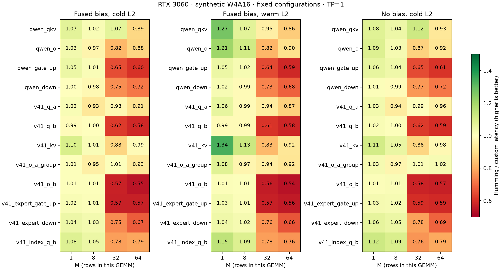

# DeepSeek V4.1 Flash shape experiment

On RTX 3060, borrowing these larger-model shapes does not increase the current
custom kernel's advantage over tuned Humming. Both implementations fuse bias
in the main comparison and read identical transformed parameter pointers.

- Large Q expansion (K=1280, N=32768): 0.991× / 0.999× at M=1/8, cold L2.
- Large output projection (K=8192, N=5120): 1.007× / 1.005× at M=1/8.
- Single-expert gate/up (K=5120, N=4608): 1.019× / 1.010× at M=1/8.
- KV (K=5120, N=512): 1.098× / 1.013× cold; 1.338× / 1.127× warm.
- Indexer Q (K=1280, N=4096): 1.085× / 1.047× cold at M=1/8.
- At M=32, large Q/output and expert gate/up fall to 0.57–0.62×: custom takes
  about 1.6–1.76 times Humming's latency. Existing configurations need a fallback
  or further kernel work in this regime.

Ratios are Humming latency divided by custom latency; larger is better.
Near-1 ratios do not establish a robust improvement. The largest difference
between confirmation round medians was 4.27%; most were much smaller.
These are individual GEMM results, not model-level speedups. Expert M means
tokens assigned to one expert, not total serving batch size.

The checkpoint's native FP8/FP4 and bias-free projections are not reproduced.
This experiment uses synthetic W4A16 group128 inputs and official projection
shapes. See [the full report](report.md) for dimensions, methodology and sources,
and [the harness documentation](../../README.md#synthetic-deepseek-v41-projection-shapes)
for commands. No checkpoint weights were downloaded.

## Bias fusion ablation

Two runs reverse bias-mode order, retain identical random inputs (seed 2),
and retain the exact custom configuration within each fused/separate pair.
Each run uses two implementation-order-reversed rounds and 150 CUPTI samples
per case. Values below combine all four round medians. Humming retains fused
bias in every arm; its results remain in the archived per-run CSVs.

| Shape | M | L2 | Fused custom (µs) | Separate add (µs) | Separate / fused |
| --- | ---: | --- | ---: | ---: | ---: |
| Qwen QKV | 8 | warm | 6.783 | 8.415 | 1.241× |
| V4.1 KV | 8 | warm | 7.631 | 9.233 | 1.210× |
| V4.1 Q expansion | 8 | warm | 73.746 | 79.264 | 1.075× |
| V4.1 O projection | 8 | warm | 67.527 | 69.715 | 1.032× |
| V4.1 Q expansion | 1 | cold | 75.556 | 74.266 | 0.983× |

Fusion helps most measured cases but is slightly slower for Q expansion at
M=1 in both cache conditions, including the reversed-mode-order confirmation.
This result does not isolate the cause. Full results are in
[bias-savings.csv](bias-savings.csv).

## Validation and artifacts

The independent confirmation has 192 shape/batch/cache/bias cases and 384
reference checks. All pass relative L2 < 0.001 and the fixed elementwise
tolerance; all also pass the original stricter atol=0.002, rtol=0.02 check.
Maximum relative L2 is 0.000542. The two bias ablation runs add 128 passing
reference checks. Repository pre-commit checks pass for the new scripts,
documentation and archived JSON.

This archive contains confirmation and tuning tables, fixed selections,
correctness records, metadata, bias ablations and PNG/SVG plots. Full raw CUPTI
samples and source snapshots remain in the original local run directories under
`/home/linxi/.local/state/vllm-qwen-int4/gemv-experiment/`:
`v41-shape-tune/`, `v41-shape-confirm/`, `v41-bias-ablation/` and
`v41-bias-ablation-reverse/`. `v41-shape-source/` holds only the pinned official
configuration and inference source, not model weights. The report's reference
to `samples.json` means that file in the original confirmation directory.

